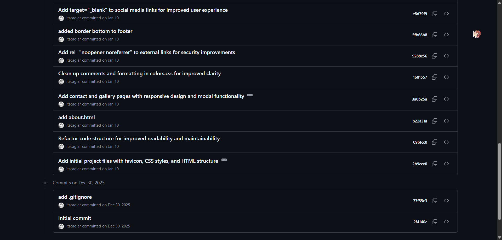

# Konu
Git ve GitHub nedir?

## Araştırma
* **Git nedir?** Projelerdeki dosya değişikliklerini takip eden, geri alınabilmesini sağlayan ve birden fazla kişinin aynı projede çalışmasını kolaylaştıran versiyon kontrol sistemidir.
* **GitHub nedir?** Git altyapısını kullanarak projelerin bulut üzerinde depolanmasını, yönetilmesini ve paylaşılmasını sağlayan web tabanlı bir platformdur.
* **Git ile GitHub arasındaki fark nedir?** Git bir araçtır, GitHub ise bu aracın kullanıldığı projeleri barındıran bir servistir.
* **Repository nedir?** Projeye ait tüm dosyaların, klasörlerin ve geçmiş değişiklik kayıtlarının tutulduğu dizindir.
* **Commit nedir?** Projede yapılan değişikliklerin onaylanarak Git tarihçesine kalıcı olarak kaydedilmesidir. Projenin o anki fotoğrafını çekmektir.
* **Branch nedir?** Ana projeden bağımsız olarak yeni özellikler geliştirmek veya hata çözmek için oluşturulan paralel çalışma alanıdır.
* **Merge nedir?** Farklı branch'lerde yapılan değişikliklerin birleştirilerek tek bir dal haline getirilmesi işlemidir.
* **Clone nedir?** Uzak bir sunucuda bulunan bir repository'nin bilgisayarınıza birebir kopyalanmasıdır.
* **Pull nedir?** Uzak sunucudaki en güncel değişiklikleri bilgisayarınızdaki yerel projeye çekme ve birleştirme işlemidir.
* **Push nedir?** Bilgisayarınızda yaptığınız commit'leri uzak sunucudaki repository'ye gönderme işlemidir.
* **.gitignore dosyasının amacı nedir?** Git tarafından takip edilmesini ve GitHub'a gönderilmesini istemediğimiz dosya ve klasörleri belirttiğimiz bir metin dosyasıdır.

## Sektörde Kullanımı
Yazılım sektöründe Git ve GitHub, ekiplerin aynı kod tabanı üzerinde çakışma yaşamadan senkronize çalışabilmesi için kullanılır. Ekipler CI/CD süreçlerini GitHub Actions gibi araçlarla otomatikleştirir, Code Review'ları Pull Request'ler üzerinden yapabilir.

## İncelediğim Projeler
**1. Proje Adı:** Git

* **GitHub Adresi:** [git/git](https://github.com/git/git)
* **Kullanılan Dil:** C, Shell, Perl
* **Projenin Amacı:** Hızlı, ölçeklenebilir bir versiyon kontrol sistemi sunarak yazılım projelerindeki dosya değişikliklerini takip etmek ve yönetmek.
* **Commit Sayısı:** 82.000+
* **Contributor Sayısı:** 1.900+
* **Klasör Yapısı**: Nereydese bütün C kodları ana dizinde bulunuyor.
* **README Yapısı**: Nasıl derlenip kurulacağını gösteren teknik bir README.md dosyası var.

**2. Proje Adı:** Linux

* **GitHub Adresi:** [torvalds/linux](https://github.com/torvalds/linux)
* **Kullanılan Dil:** C, Assembly
* **Projenin Amacı:** Donanım ile yazılım arasındaki iletişimi sağlayan, bellek yönetimi ve sistem kaynaklarının dağıtımını üstlenen açık kaynaklı işletim sistemi çekirdeğini (kernel) geliştirmektir.
* **Commit Sayısı:** 1.505.000+
* **Contributor Sayısı:** 20.200+
* **Klasör Yapısı**: `/arch`, `/drivers`, `/fs`, `/kernel` gibi klasörler barındırıyor. Aşırı geniş bir dizin yapısına sahip.
* **README Yapısı**: Devasa bir proje olmasına rağmen oldukça kısa bir README.md dosyası var.

**3. Proje Adı:** Godot Engine

* **GitHub Adresi:** [godotengine/godot](https://github.com/godotengine/godot)
* **Kullanılan Dil:** C++, C#, C, GDScript
* **Projenin Amacı:** 2D ve 3D oyunlar geliştirmek için açık kaynaklı bir oyun motoru sunmaktır.
* **Yaklaşı Commit Sayısı:** 87.000+
* **Contributor Sayısı:** 3.400+
* **Klasör Yapısı**: `/core`, `/editor`, `/scene`, `/platform`, `/modules` gibi klasörler barındırıyor. Düzenli ve modüler bir yapısı var.
* **README Yapısı**: Motorun kısa özetini ve kaynak kodunun nasıl derleneceğini içeriyor.

## Yaptığım Uygulama
Kişisel websitem: [itscaglar/caglargundog](https://github.com/itscaglar/caglargundog)

Proje sadece statik dosyalardan (HTML, CSS, JS) oluşmaktadır. Çalıştırmak için herhangi bir tarayıcıdan açmanız yeterlidir.

## Karşılaştığım Problemler
* Commitleri isimlendirmek çok zor.
* Merge Conflict: Tek çözüm yolu manuel işlem yapmak.

## Öğrendiklerim
* Temel git döngüsü
* Dallanma ile güvenli geliştirme ortamı sunması

## Kaynaklar
* [What is Git?](https://git-scm.com/book/en/v2/Getting-Started-What-is-Git%3F)
* [Git Cheat Sheet](https://git-scm.com/cheat-sheet)
* [What is Github?](https://docs.github.com/en/get-started/start-your-journey/what-is-github)