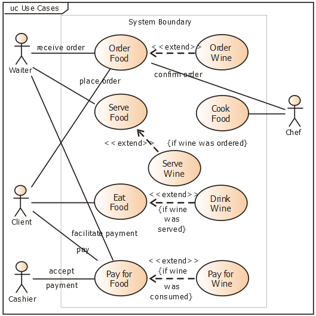
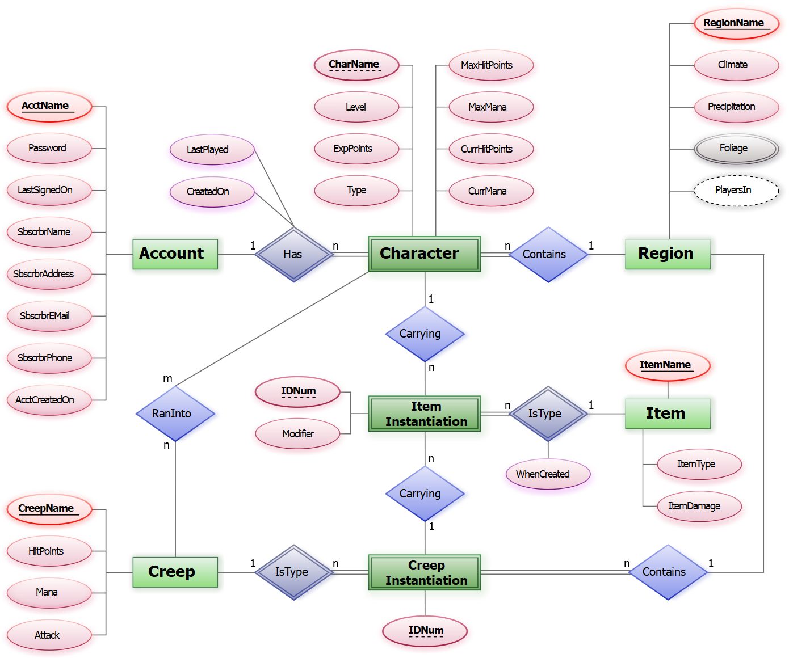
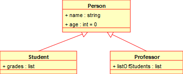

# Konu
UML Diyagramları (Use Case, ER ve Class Diyagramları)

## Araştırma
UML (Birleşik Modelleme Dili), yazılım sistemlerinin yapısını, tasarımını ve işleyişini standartlaştırılmış grafiksel şekillerle görselleştirmeye yarayan evrensel bir modelleme aracıdır. Yazılım geliştirme sürecinde karmaşık gereksinimleri ve mimariyi, hem teknik ekibin hem de müşterilerin kolayca anlayabileceği ortak bir dile dönüştürür. Temel problemi, kodlama aşamasına geçmeden önce sistemin hatasız bir şekilde tasarlanmasını sağlamak ve kalabalık geliştirici ekipleri arasındaki iletişimi standartlaştırmaktır.

* Aktörlerin sistemle olan etkileşimlerini ve temel senaryoları modellediğimiz **Use Case Diyagramı**.

* Veritabanında tutulacak varlıkları ve bu varlıkların birbirleriyle olan bağlarını modellediğimiz **ER (Varlık-İlişki) Diyagramı**.

* OOP mantığıyla sınıfların özelliklerini, metotlarını ve birbirleri arasındaki yapısal ilişkileri detaylandırdığımız **Class Diyagramı**.

## Örnekler

### Use Case Örneği

### ER Diyagram Örneği

### Class Diyagramı Örneği
